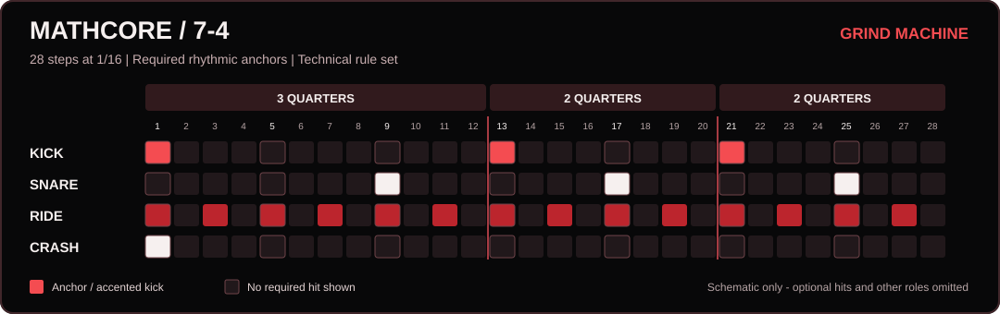
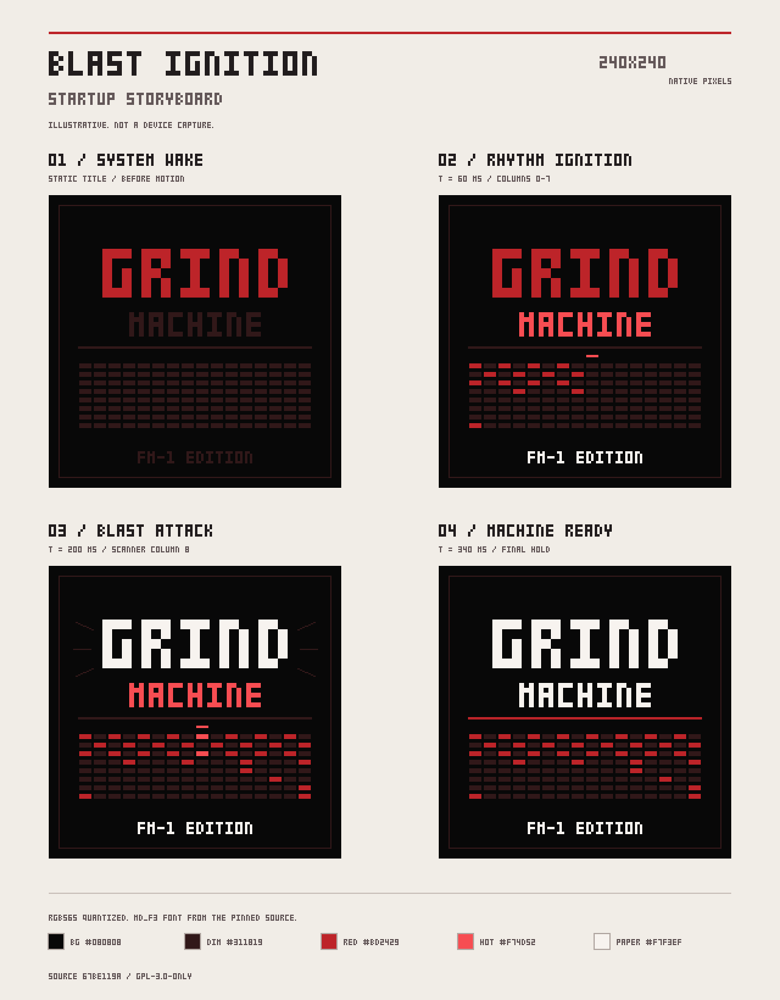

# GRIND MACHINE — FM-1 Edition

[](https://github.com/DaFum/grind-machine/actions/workflows/grind.yml)
[](LICENSE)
[](docs/grind/compatibility.md)

**Extreme metal drum-machine firmware for the M-VAVE FM-1.** Generate blastbeats, doublebass, D-beats, breakdowns, odd-meter technical rhythms and crushing doom grooves, then shape them on the FM-1's own keys, knobs and 240 × 240 screen.

GRIND MACHINE builds on [Hortator](https://github.com/DeadActive/hortator) by DEADACTIVE and [Felucca](https://github.com/hugelton/Felucca) by Leo Kuroshita. It combines an eight-track native drum machine with a deterministic rhythm generator. Play and edit without a computer; use the optional USB editor for detailed sound design, patterns, samples and backups.

[**Pre-releases and downloads**](https://github.com/DaFum/grind-machine/releases) · [**Preview installer**](https://dafum.github.io/grind-machine/webapp/installer/) · [**GRIND controls**](docs/grind/live-pages.md) · [**Changelog**](CHANGELOG.md) · [**User manual**](docs/manual/01-welcome.md)

> [!WARNING]
> **Development firmware. Install at your own risk.** Published GRIND packages are previews, not hardware-qualified releases. Host tests, WASM and a successful native build do not establish that your physical FM-1 is compatible. Back up your data and prepare a verified recovery route before installing. Some inherited assets have restricted or unresolved rights; see [LICENSING.md](LICENSING.md) and the [asset inventory](assets/grind/manifest.json). No automatic flashing or release approval is implied.

## Current development status

| Area | Status |
| --- | --- |
| Portable GRIND rhythm engine | Implemented: 22 stable core algorithms and deterministic generation |
| GRIND-native build of main | Implemented: 23 selectable styles including Mathcore 7/4, five GRIND pages, style preview, VARY, LIVE macros |
| USB GRIND editor and song-excerpt tools | Implemented in source; compatible firmware required for device writes |
| Published package | [Preview.4](https://github.com/DaFum/grind-machine/releases/tag/grind-v0.1.0-preview.4), commit `24cf6b7`; predates the new 23-style / LIVE expansion |
| BLAST IGNITION and GRIND DNA ENGINE | Approved design and implementation plans, not implemented firmware |
| Physical FM-1 qualification | Not established; see [compatibility and recovery](docs/grind/compatibility.md) |

This README describes **main with `GRIND_NATIVE=1`**, including the community expansion merged in [PR #19](https://github.com/DaFum/grind-machine/pull/19). GRIND remains opt-in at build time; the default `GRIND_NATIVE=0` build keeps the underlying drum-machine behavior. The published installer may contain an older commit than main. Read its version label and the package's release notes rather than assuming every feature below is in the download.

## What it does

| System | What you can do |
| --- | --- |
| **GRIND rhythm engine** | Generate extreme-metal patterns across eight roles; control aggression, density, chaos, humanize and mutation. |
| **Sequencer** | Up to 64 steps per track, independent timing, accents, probability, ratchets, nudge, fills, recording and step tools. |
| **Sound engine** | 808/909-style drums, physical-model percussion, samples and ACID bass on up to two tracks. |
| **Live performance** | Native pattern cue, KEEP, undo/redo, mutes/solo, PERFORM effects, SINK, SWELL and CUT. |
| **Studio workflow** | MIDI clock, USB audio, per-track automation, projects, variations and a capability-gated USB editor. |
| **Browser simulator** | Run the same firmware sources compiled to WebAssembly; use the mouse, touch or keyboard. Build the GRIND-enabled simulator locally. |

## The GRIND engine

### 23 selectable styles

The native STYLE selector contains 22 stable generator algorithms plus the 7/4 Mathcore entry. MATH uses Technical's seven-quarter rule, not a new serialized algorithm ID.

| Family | Styles |
| --- | --- |
| Blastbeats | Traditional, Hammer, Bomb, Gravity |
| Grindcore | Grind Blast, D-Beat, Skank |
| Death metal | Doublebass, Technical, Brutal |
| Powerviolence | Fast-Slow, Abrupt Break, Stop-and-Go |
| Hardcore | Breakdown, Two-Step, Half-Time |
| Experimental | Chaos, Industrial, Polymetric |
| Doom | Sludge, Funeral, Stoner |
| Mathcore | **MATH / 7/4** (Technical in 3+2+2) |

The generator writes tracks 1–8 as **Kick · Snare · Hi-hat · Ride · Crash · China · High tom · Low tom**. With the same config, seed, mutation and protected base, the portable core generates the same pattern. It uses the existing native sequencer, rather than starting a second timing or audio engine.

### Mathcore 7/4



*Original rhythm schematic of the required anchors; not a screenshot or a complete generated pattern.* One bar is 28 sixteenths, 14 eighths or 56 thirty-seconds. Two bars of sixteenths fit in 56 steps. Other styles do not automatically gain 7/4 rules; incompatible grids are refused instead of silently changing the meter.

The portable core also supports 3/4, 4/4, 5/4, 6/8, 7/8 and 9/8, within its 64-step limit and each style's constraints. See the [core contract](docs/grind/portable-core.md) and [7/4 implementation](firmware/src/grind/rules.c).

### Five native GRIND pages

Press **ARP**, then **ARP again after GRIDS** to enter GRIND on a supported build. Use the existing page navigation and the four parameter knobs.

| Page | KNOB 1 | KNOB 2 | KNOB 3 | KNOB 4 |
| --- | --- | --- | --- | --- |
| 1 · Generate | STYLE | AGGR | DENS | CHAOS |
| 2 · Feel | HUMAN | MUT | WHEN | KIT |
| 3 · Protect | KEEP | UNDO | FREE | VARY |
| 4 · LIVE | SINK | SWELL | CUT | — |
| 5 · Browse | STYLE | BANK | APPLY | — |

- **AGGR / DENS / CHAOS / HUMAN:** shape accents, optional hits, controlled rhythmic variation and microtiming. A style change restores that style's factory controls.
- **MUT:** generate another deterministic variation. **WHEN:** apply now when stopped, or at the next STEP / END of the longest pattern during playback; all tracks restart together at the native boundary.
- **KIT / ROLE:** turn twice to confirm the role sounds while stopped; levels, pans, sends and steps stay intact. This is a sound starting point, not a claim of hardware-tuned acoustic modeling.
- **KEEP / FREE:** protect complete ON or OFF cells (hold a step key in STEPS/ENV on a GRIND page), or protect/release the selected track; FREE releases all tracks. A protected cell that cannot fit the new grid causes refusal. KEEP is distinct from parameter locks.
- **UNDO:** toggle the last generated pattern change back and forward (one snapshot of steps/timing). Later manual edits can be replaced by it; this is not a general edit history. Save before experimenting.
- **STYLE browser:** inspect all 23 styles using eight-role, 16-step banks with accents, ratchets and KEEP marks. BANK scrolls long patterns; APPLY commits through the normal STYLE request. Leaving without applying cancels the browse. PREVIEW WAITS / KEEP DOES NOT FIT / NO PREVIEW report an unavailable candidate.

Live edits of steps or timing invalidate a waiting generation; a running SONG refuses generation. STYLE and WHEN are retained in device settings; other GRIND controls, KEEP, and the undo snapshot are not saved as a new recipe format. SAVE stores the actual native pattern. Read the [GRIND page reference](docs/grind/live-pages.md) for exact behavior.

### VARY — natural hit variation

VARY adds deterministic per-hit velocity variation (up to ±8 at 100%). Unlike HUMAN, it changes playback velocity rather than rewriting timing. It affects ordinary drum steps and their ratchets, including manually programmed and kept steps; manual hits, MIDI-triggered hits and ACID/gated tracks are excluded. At zero the existing sound is unchanged. VARY is not a persisted project parameter.

### LIVE — performance macros

| Macro | Action |
| --- | --- |
| **SINK** | Push the existing master filter toward low-pass; a stronger existing LPF remains in effect. |
| **SWELL** | Smoothly increase delay and reverb sends through the existing THROW macro. |
| **CUT** | Stop the normal transport, drop queued/staged changes and cut track voices; delay/reverb tails ring out. PLAY restarts normally. |

SINK and SWELL at zero preserve the original audio path. These levels are not stored and reset at power-up or TOOLS INIT. CUT is a performance action, **not** a recovery command: an FM-Link follower may continue following its leader and a held MIDI REPEAT STEP can continue, as with ordinary STOP. See [LIVE limits](docs/grind/live-pages.md#live-macros-page-4).

## Native drum-machine toolkit

### On the panel

The inherited [FM-1 panel diagram](docs/panel.jpg) shows the physical controls (copyright Hügelton Instruments; not a GPL asset). The [panel manual](docs/manual/03-panel.md) covers the standard navigation.

| Control | Function |
| --- | --- |
| HOME | TRACKS mixer / HOME and compressor; hold for menu |
| EDIT | Model, SOUND pages, preset list and LAYER |
| SEQ | Steps, PATTERN, MOTION, SONG; hold for step tools |
| FX | FILTER, FX sends, INSERT/SRR, SLICER, RESON; hold for PERFORM |
| ARP | GRIDS; continue into GRIND on the enabled build |
| LFO | Two LFOs and their four destination slots per track |
| REC | Arm recording on TRACKS, REC ALL elsewhere, step record in KEYS |
| GLO | Global settings/effects; hold for MUTE, SOLO and MIDI LEARN |
| SAVE | Project and copy tools; hold for live cue and variations |
| SCL / SEL, ENV | KEYS / STEPS modes and step locks |
| ALGORITHM, SELECT, PRESETS | Track, page/menu or tempo, sound preset |

PLAY controls transport; REC alone does not start it. OCT-/OCT+ navigate banks or octaves according to mode. The [quick start](docs/manual/02-quick-start.md) and [sequencer manual](docs/manual/04-sequencer.md) explain the existing key and hold gestures.

### Sounds, presets and samples

- Drum synthesis: 808/909-style kicks, snares, claps, hats, toms and percussion, Plaits-derived drum algorithms and modal resonators. The SAMPLE model supports user recordings.
- ACID: saw/square bass with resonant filter, accent, slide and tie; at most two ACID tracks. Enter notes in KEYS mode or step record; the native note-length safety limit remains in force.
- 151 factory presets and 96 user slots; user presets retain sound and supported track FX, factory presets change the voice only. Older voice-only user presets migrate on first load; if no slots are free some may be lost. Back up first.
- User sample sets: up to 16 samples per set, mono IMA ADPCM up to 44.1 kHz, KEY and CHOP modes, start/end, envelopes and loop modes. USR1 is 80 KiB; USR2 and USR3 are 48 KiB each.

**Do not upload an upstream 80-KiB sample into USR2 or USR3 with Felucca's tools:** those addresses share the flash region with Hortator/GRIND variation and lock data. Longer legacy samples may be shortened during migration. See [sounds and sample limits](docs/manual/07-sounds.md) and [storage layout](docs/grind/storage-layout.md).

### Sequencing, modulation and effects

| Area | Features |
| --- | --- |
| Steps | Independent LEN/DIV/swing, PROB, RATCH, ACCENT, NUDGE ±50, fill conditions, copy/paste and step recording |
| Automation | Per-step parameter locks, up to 1024 MOTION events per project, two tempo-syncable LFOs per track |
| Grids | Mutable Instruments pattern map, chaos and Euclidean rhythms |
| Voice and track FX | FILTER, SRR, DIST, INSERT (drives, crusher, phaser, flanger, chorus), SLICER, RESON and KEYFOLLOW |
| Shared FX | Delay with ping-pong, room/spring/stereo hall reverb, chorus sends, sidechain compressor with GHOST and master limiter |
| Playing live | PERFORM buffer/filter effects, REPEAT STEP, persistent performance knobs, immediate or next-bar mute, toggle/momentary solo |

The native voice scheduler sheds voices under heavy load to protect the audio deadline; track PRIO influences which voices go first. This is not a guarantee of unlimited polyphony. See [effects](docs/manual/08-effects.md), [modulation](docs/manual/09-modulation.md), [playing](docs/manual/05-playing.md) and [performance](docs/PERFORMANCE.md).

### Projects and live cue

Four flash project slots (A–D), eight pattern variations per project, native quantized cueing, and SONG chains of up to 16 rows with repeats. Projects hold concrete steps, timing, sound settings, effects, locks and motion. Edits stay in RAM until SAVE; another load may require confirmation. The last saved project can load on boot. Unsupported flash chips use RAM-only saving.

Backup and restore are not interchangeable with undo or KEEP. Preserve your presets, projects and sample data before switching firmware. Some newer project formats cannot be read by older firmware. See [project compatibility](docs/manual/06-projects.md).

### MIDI and USB audio

The inherited connection options include USB MIDI, TRS MIDI input where built/enabled, MIDI LEARN (up to 32 bindings), MIDI clock input/output and THRU. The non-BLE build supports stereo USB audio or 10-channel modes (master plus eight tracks). The USB names retain the upstream Hortator/Felucca update conventions; the GRIND package identity is **FM-1_984**, distinct from Hortator's FM-1_900. Do not infer package identity from a cached USB port name.

Read [MIDI](docs/manual/10-midi.md) and [USB audio](docs/manual/11-usb-audio.md). The inherited experimental Bluetooth build offers BLE-MIDI, FM-Link and SMC-Mixer integration, with stereo USB audio only and lower audio headroom; it is not the qualified target of the current GRIND preview. Disconnected saved BLE devices can cause stutter. Bluetooth is off by default unless autostart was configured; see the [Bluetooth manual](docs/manual/12-bluetooth.md).

### Settings

Color themes, metronome, knob acceleration, key backlight, speaker EQ, panel calibration and MIDI/USB options use the existing controls. Calibration can be canceled (hold the asked-for key for 1.5 s, or press a key while teaching a knob). RESET TO DEFAULT restores panel and ordinary settings, including GRIND STYLE/WHEN, after its two-step OCT+ confirmation; projects, presets and samples are not erased. See [settings](docs/manual/13-settings.md).

## Web editor

The local USB web editor exposes the device's capabilities via SysEx. Use a Web-MIDI-capable browser (Chrome or Edge recommended), grant SysEx permission and connect the device by USB.

| Tab | Capabilities |
| --- | --- |
| Sound | Track sound, global and effect controls with device readback |
| Presets | Factory/user presets, save, rename, reorder and backups |
| Projects | Backup/restore saved projects and copy slots |
| Patterns | 64-step editing, accents, probability, ratchets, nudge, locks, variation copy/cue and stopped SAVE |
| Samples | Load, preview, trim, normalize, resample, chop and back up sample sets |
| **GRIND** | Style (including MATH on current main), AGGR/DENS/CHAOS/HUMAN/MUT/WHEN, role kit, KEEP and undo/redo; pending-commit status |

The new panel-only VARY and LIVE controls and dedicated native style-preview page are not advertised as new editor controls. Older firmware without the GRIND capability keeps the existing tabs. Restores and sample uploads are stopped-only. A canceled sample upload can leave the slot empty; keep the source file. Backups cover saved data, so save edits first. Big transfers while clocking a DAW may introduce clock jitter. The editor yields to updates and does not use Bluetooth as an editor link.

**Current GRIND site:** the preview workflow publishes the installer/package, not a hosted GRIND editor or simulator. Build the site from this repository for the matching editor. The original [Hortator editor](https://deadactive.github.io/hortator/webapp/editor/) and [Hortator manual](https://deadactive.github.io/hortator/manual/) are upstream references, not the current GRIND build. See [editor manual](docs/manual/14-web-editor.md) and [wire protocol](web/EDITOR_PROTOCOL.md).

## Song patterns

The local [song-excerpt utility](tools/songs_pattern.py) reads JSON notes with a tempo map. It maps drum hits to the eight GRIND roles, quantizes a four-bar 16th-note window, preserves representable microtiming, and compares role density and rhythmic shape against the existing 22-style reference patterns. It can send the selected pattern to a stopped compatible FM-1 over USB MIDI; writes and saves are explicit.

Read-only examples from the repository root:

```sh
python3 tools/songs_pattern.py list assets/songs/rhythm_songs.json
python3 tools/songs_pattern.py compare assets/songs/rhythm_songs.json
```

This is **not** an audio transcription model or the planned GROOVE DNA / RIFF INTELLIGENCE engine. The [band's song excerpts](assets/songs/README.md) are reference data outside the firmware package and not covered by the code's GPL licence.

## Roadmap

### BLAST IGNITION — startup animation

<p align="center">
  
</p>

**Design only:** a dark industrial title and an interruptible, silent sequencer pulse with existing pixel glyphs and canvas rendering. SYSTEM WAKE appears at the early title hook; the moving presentation uses a 400 ms target in the normal UI loop after the inherited boot sequence, without adding a blocking wait. Normal input, SAFE START, calibration, updates and error notices take priority. The storyboard is illustrative, not a real device screenshot or timing measurement.

[Design specification](docs/superpowers/specs/2026-11-27-grind-blast-ignition-design.md) · [Implementation plan BA01–BA06](docs/superpowers/plans/2026-11-27-grind-blast-ignition-implementation.md)

### GRIND DNA ENGINE — virtual extreme-metal drummer

**Design only:** hybrid standalone device generation and local computer/editor analysis, without a cloud service.

| Module | Planned behavior |
| --- | --- |
| RIFF INTELLIGENCE | Capture MIDI phrases and respond at native pattern boundaries; no claim of guitar audio/articulation recognition. |
| DRUMMER BRAIN | Six virtual drummer profiles, optional hand/foot coordination and a machine mode. |
| GROOVE DNA | Compact statistical rhythm profiles extracted from local song data, rather than copying songs. |
| GENETIC BREEDING | Deterministic blending of style rules, mutation and protected-cell-aware generation. |

[Design specification](docs/superpowers/specs/2026-11-27-grind-dna-engine-design.md) · [Implementation plan D01–D07](docs/superpowers/plans/2026-11-27-grind-dna-engine-implementation.md)

### Remaining community extensions

Per-style preferences, ANCHOR/RETURN, COMPARE, Scene Morph and UNDERGROUND FX (Tape, AM, Phone) remain unimplemented/deferred; the current native application has limited free RAM. See [community expansion plan](docs/superpowers/plans/2026-11-27-grind-community-feature-expansion.md) and [current native page notes](docs/grind/live-pages.md#not-built-ram). The original [design](docs/superpowers/specs/2026-11-27-grind-machine-design.md) and [implementation roadmap](docs/superpowers/plans/2026-11-27-grind-machine-implementation.md) remain the source of planning scope and the approved community quality policy.

## Install

1. **Before a device write:** identify your exact FM-1, back up settings/presets/projects/samples using a compatible tool, charge the device, and have the official updater, stock firmware and recovery instructions ready. Returning to stock does not automatically restore user data.
2. Check the chosen [GRIND pre-release](https://github.com/DaFum/grind-machine/releases), package source commit, licence notices and SHA256SUMS.txt. The [preview installer](https://dafum.github.io/grind-machine/webapp/installer/) publishes an unqualified package; check its displayed version.
3. For an intentional preview installation, follow the [device-install guide](docs/DEVICE_INSTALL.md) and the compatible web installer in Chrome/Edge with a known-good USB data cable. Do not disconnect during an update. Stop at the first unexpected result. Historical documentation contains upstream Hortator links and package names; use the GRIND release identity and source commit for this fork.

A read-only identity check (requires the existing Python MIDI dependencies):

```sh
python3 tools/fm1_install.py --info
```

The CLI can also install a selected package, but no install command is needed to explore the software or run host tests. Do not bypass the installer identity checks. See [hardware compatibility](docs/grind/compatibility.md).

### Back to the official firmware

The inherited **SAFE START** path is entered by powering off, holding SEQ during power-on until SAFE START / NO AUDIO – USB UPDATE READY appears, then releasing. It skips the drum engine and leaves USB update available; power off to exit. Use M-VAVE's official M-UPGRADE and the matching official FM-1 firmware from [M-VAVE downloads](https://www.m-vave.com/download). Follow the [recovery guide](docs/RECOVERY.md) if normal update fails. The documented Mac boot-mode recovery has prerequisites; hardware recovery using an [FM-1 Transporter](https://github.com/kurogedelic/FM-1-transporter) may be needed if the device cannot enter boot mode. Recovery is not guaranteed for every fault.

## Build and try locally

Start with [BUILDING.md](BUILDING.md), which documents the pinned JieLi Linux toolchain and AC79 SDK. The native device compiler is not your desktop GCC; host tests use the desktop compiler separately. Native compilation runs on Linux x86-64 or with the documented Docker setup. Python 3/Pillow are used for generated headers; Emscripten/Docker and Node are used for the simulator.

```sh
# Generate headers and run the portable + native-host GRIND suites.
python3 tools/build.py --gen-only
sh tests/run_grind_tests.sh all

# Build the shared-code simulator without flashing a device.
GRIND_NATIVE=1 bash tools/build_sim.sh --preview
cd build/sim/preview
python3 -m http.server 8001
```

Open `http://localhost:8001/` for the local simulator. The preview without a package is not a firmware installer. The [simulator guide](docs/SIMULATOR.md) explains the build, existing host tests and WebAssembly UI.

For a native build from the repository root with the required toolchain/SDK installed:

```sh
GRIND_NATIVE=1 ./build.sh
# Deliberately request a local installable preview package and matching site:
GRIND_NATIVE=1 DRUM_PACKAGE=1 ./build.sh
```

These build commands do not flash a device. To serve the matching locally generated site (including editor), use `python3 -m http.server 8000` from `build/site`, then open `http://localhost:8000/webapp/editor/`. A package is still unqualified even when its build succeeds.

### Tests and evidence

```sh
sh tests/run_grind_tests.sh all
sh tests/run_drum_tests.sh
GRIND_WASM=1 sh tests/run_grind_tests.sh all
GRIND_NATIVE=1 bash tools/build_sim.sh --host-only
```

Run with the documented compilers and dependencies; the runner accepts exactly one suite argument (or all). Existing [Foundation CI](https://github.com/DaFum/grind-machine/actions/workflows/grind.yml) covers the portable core/golden vectors, native-host tests, WASM/browser, upstream regressions, performance, target build/packages and asset evidence. The existing [community quality policy](docs/superpowers/plans/2026-11-27-grind-machine-implementation.md#community-quality-policy-user-approved-direction-revision-11) governs the evidence; no new release thresholds are introduced here. Check actual job results and hardware status separately.

## Layout and documentation

| Path | What lives there |
| --- | --- |
| `firmware/src/grind/` | Portable rhythm core, native adapter, runtime, GRIND UI and hit variation |
| `firmware/src/`, `firmware/hal/`, `firmware/loader/` | Inherited native drum engine, UI, hardware layer and update loader |
| `web/editor/`, `web/sim/` | USB editor and same-source WASM simulator |
| `tests/grind/`, `tests/` | Focused GRIND fixtures and inherited firmware/simulator tests |
| `tools/grind/`, `tools/` | CI evidence, build, packaging, song-pattern and installer utilities |
| `docs/grind/`, `docs/manual/` | Current GRIND-specific references and inherited detailed user manual |
| `assets/` | Fonts, samples, artwork and provenance; not all assets are GPL |

[GRIND integration map](docs/grind/integration-map.md) · [Storage layout](docs/grind/storage-layout.md) · [Device install](docs/DEVICE_INSTALL.md) · [Troubleshooting](docs/manual/17-troubleshooting.md) · [Versioning](docs/VERSIONING.md) · [Agent instructions](AGENTS.md)

The [historical full README](https://github.com/DaFum/grind-machine/blob/5d5975cefe5ee954b3eb5c9b39ea5aa5737e5698/README.md) retains the long-form Hortator-derived control reference. It predates this rewrite and has upstream names and outdated GRIND feature counts. For current GRIND behavior, prefer this README, the linked source and GRIND page notes. The inherited public Hortator site uses [GoatCounter](https://www.goatcounter.com) for visits and completed installs; see the previous README's privacy notes for that deployment. This rewrite adds no analytics.

## Credits

- GRIND MACHINE by the contributors to this repository; based on Hortator by DEADACTIVE. BLE MIDI: 2026 DEADACTIVE.
- [Felucca](https://github.com/hugelton/Felucca) by Leo Kuroshita ([@kurogedelic](https://github.com/kurogedelic)),
  [Hügelton Instruments](https://hugelton.com): the firmware Hortator is built on, its hardware layer, update
  loader, installer, UI and engines; the per-track INSERT effect is Felucca 1.5's, as ported to Skiff (by
  DEADACTIVE) and from there to Hortator; the HALL reverb is Skiff's (Felucca's stereo HALL, Skiff 1.3.2).
- [Grids](https://github.com/pichenettes/eurorack/tree/master/grids) by Emilie Gillet, Mutable Instruments: the GRIDS
  pattern engine is a C port (GPL-3.0-or-later).
- [Streams](https://github.com/pichenettes/eurorack/tree/master/streams) by Emilie Gillet, Mutable Instruments: the
  compressor is a C port (MIT).
- [Plaits](https://github.com/pichenettes/eurorack/tree/master/plaits) by Emilie Gillet, Mutable Instruments: integer
  ports of its drum algorithms and stmlib (MIT).
- [DaisySP](https://github.com/electro-smith/DaisySP) by Electrosmith and Emilie Gillet: the modal resonator and
  membrane of the SKIN engine and the RESON effect are fixed-point ports (MIT).
- Pixel font and VU logo: drawn by DEADACTIVE.
- Font: [Terminus](https://terminus-font.sourceforge.net/) by Dimitar Toshkov Zhekov,
  [SIL OFL 1.1](assets/fonts/Terminus-LICENSE.txt).
- Samples: [Versilian Studios](https://versilian-studios.com/) VSCO-2 Community Edition and VCSL, CC0 1.0
  ([attribution](assets/samples-cc0/ATTRIBUTION.txt)); the Hügelton Sample Pack (© Hügelton Instruments, not CC0).
- Web editor icons: Fukiai by Hügelton Instruments, [MIT](web/FUKIAI-LICENSE.txt).
- Package format and boot files: [JieLi AC79 SDK](https://gitee.com/Jieli-Tech/fw-AC79_AIoT_SDK) (Apache-2.0, not
  included).
- Recovery tool: [jl-uboot-tool](https://github.com/kagaimiq/jl-uboot-tool) by Andrey Grigoryev (kagaimiq), MIT.
- Boot screen study: UnifrakturMaguntia and UnifrakturCook by j. 'mach' wust and Peter Wiegel, SIL OFL 1.1.
- Research: the MD voices were measured from Joe Landers' Machinedrum emulator, a fork of
  [Gearmulator](https://github.com/dsp56300/gearmulator) by The Usual Suspects (the DSP56300 project); measurements
  only, no code or data from it. Machinedrum is a trademark of Elektron. Hortator is not affiliated with Elektron,
  Joe Landers or The Usual Suspects.

## Licence

Code: [GPL-3.0-only](LICENSE). Assets and third-party material: [LICENSING.md](LICENSING.md).

M-VAVE and FM-1 are trademarks of their respective owners. GRIND MACHINE and Hortator are independent firmware projects that run on FM-1
hardware; they are not affiliated with, endorsed by or supported by the hardware manufacturer. The plain version never enables the
hardware's Bluetooth / Wi-Fi radio; the Bluetooth version turns on Bluetooth only when you set BLUETOOTH ON (or
AUTOSTART ON: then 5 s after each power-on).

Copyright (C) 2026 Leo Kuroshita (@kurogedelic), Hügelton Instruments; drum machine fork: 2026 DEADACTIVE; BLE MIDI:
2026 DEADACTIVE.
