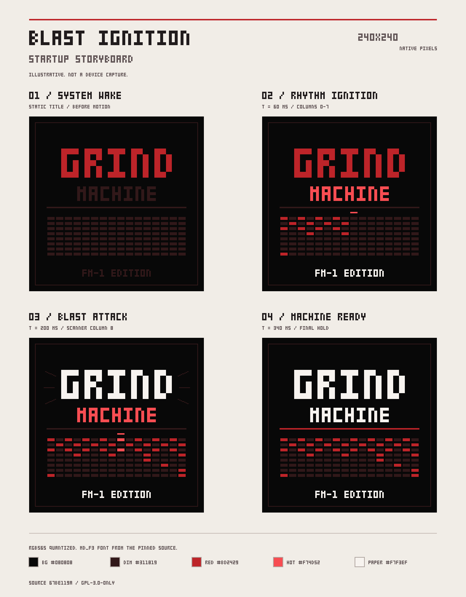
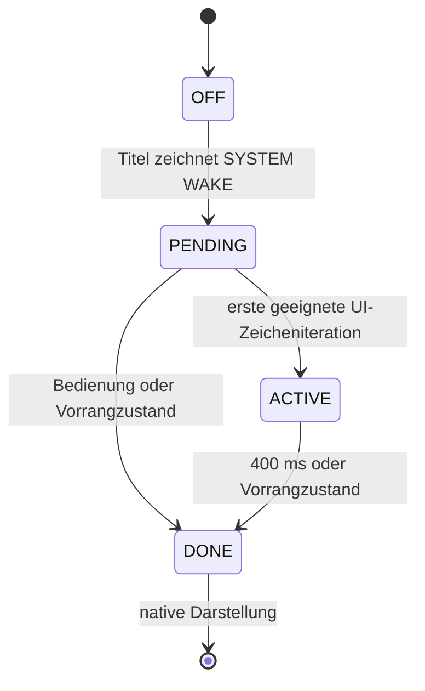

# GRIND MACHINE — BLAST IGNITION

**Detaillierte Designspezifikation · 27. November 2026**

**Status:** Gestaltungsrichtung vom Auftraggeber genehmigt; dieses Dokument konkretisiert die Umsetzung.

**Repository:** `DaFum/grind-machine` · **untersuchte Basis:** `67be119a59b11d0ae154217d9248becefca59190`

**Umsetzung:** [Implementierungsplan BA01–BA06](../plans/2026-11-27-grind-blast-ignition-implementation.md)

## 1. Ergebnis und Einordnung

BLAST IGNITION ist eine kurze, stumme Startinszenierung für das 240×240-Pixel-Display der GRIND MACHINE. Ein dunkles, industrielles Wortzeichen wird durch ein achtspuriges Rhythmusraster aktiviert: **SYSTEM WAKE → RHYTHM IGNITION → BLAST ATTACK → MACHINE READY**. Das große `GRIND`, das kleinere `MACHINE` und `FM-1 EDITION` bilden die Hierarchie. Die Bewegung entsteht aus festen Pixeln, Linien und Rechtecken der vorhandenen Grafikfunktionen.

Das Verhalten gehört zu FR-01 der [Produktspezifikation](2026-11-27-grind-machine-design.md). Es ergänzt die vorhandene UI und ist unabhängig von der Community-Erweiterung und der DNA ENGINE. Die Erstellung dieses Dokuments und seines Plans implementiert keine Firmware und belegt keine Gerätefunktion.

### 1.1 Präzisierung des Startfensters nach Quellcodeprüfung

Der vorhandene Startablauf zeichnet `draw_boot_title()` unmittelbar nach `lcd_init()`, noch vor Input-, Audio-, USB- und Timer-Initialisierung. Danach folgen unter anderem eine 30-ms-Wartezeit, die mögliche Hardware-Kalibrierung und `fm1_delay_ms(400)`. Erst anschließend beginnt die normale UI-Schleife. Die 400-ms-Zeile und die HAL-Wartefunktion sind durch die bestehenden Schutzprüfungen festgeschrieben; die Wartefunktion hat keinen Zeichen-Callback. [S1, S2]

Deshalb lautet die konkrete Integration:

1. **SYSTEM WAKE** ersetzt das bestehende statische Titelbild am vorhandenen Hook.
2. Der unveränderte Initialisierungsablauf einschließlich seiner Wartezeiten läuft weiter.
3. **Die bewegte Sequenz dauert nominell 400 ms ab der ersten geeigneten normalen UI-Zeicheniteration.** Die Firmware bedient dabei weiterhin ihre normale Hauptschleife. Jede Bedienung beendet die Darstellung sofort zugunsten ihrer eigentlichen Funktion.
4. Nach Ablauf oder Abbruch zeichnet die native UI ihren tatsächlich gewählten Zustand vollständig neu.

Diese Lösung fügt keine zeitgesteuerte blockierende Wartephase hinzu. Sie zeigt das Branding auf einem unbedienten Gerät jedoch bis zu 400 ms länger nach Eintritt in die UI-Schleife. **400 ms ist kein Versprechen über die gesamte Einschaltzeit.** LCD-Übertragungen benötigen weiterhin ihre reale Laufzeit. Die frühere Konzeptidee, mehrere Bilder innerhalb der bestehenden 400-ms-Wartefunktion zu zeichnen, wird durch diese quellcodekonforme Lösung ersetzt. `main.c`, HAL, Loader, Bootguard, Zeitbasis und `tools/check_untouched.py` werden dafür nicht geändert.

### 1.2 Geltende Qualitätsregeln

Es gilt die bereits genehmigte [Community quality policy](../plans/2026-11-27-grind-machine-implementation.md#community-quality-policy-user-approved-direction-revision-11). Die nachfolgenden Zeit-, Farb- und Geometriewerte sind Gestaltungs- beziehungsweise Funktionsvorgaben. Sie begründen keine zusätzlichen Freigaben, Zertifizierungen, Mindest-FPS, Latenzgrenzen, Stresslaufzeiten oder prozentualen Ressourcenreserven. Der Plan verwendet die vorhandenen funktionalen Tests, Schutzprüfungen, Build-Werkzeuge und tatsächlichen Gerätegrenzen. Fehlende Gerätebefunde bleiben als solche erkennbar.

## 2. Visuelle Sprache

### 2.1 Komposition



Das Storyboard ist eine Designillustration mit den vorhandenen `MD_F3`-Glyphen, kein Firmware-Screenshot. Zeitangaben in den bewegten Ansichten beziehen sich auf den Beginn der normalen Präsentation, nicht auf das Einschalten. Die äußeren Beschriftungen des Storyboards erscheinen nicht auf dem Gerät.

| Element | Exakte Geometrie in Display-Pixeln | Ausführung |
|---|---|---|
| Hintergrund | `(0,0)`, `240×240` | Konstantes fast schwarzes Feld |
| Rahmen | `cv_frame(8,8,224,224,...)` | 1-Pixel-Linie, ruhiger dunkler Rand |
| `GRIND` | `(44,44)`, `152×40` | `MD_F3`, ganzzahliger Maßstab 8 |
| `MACHINE` | `(66,96)`, `108×20` | `MD_F3`, Maßstab 4 |
| Trennlinie | `(24,124)`, `192×2` | Dunkel, in READY rot |
| Laufmarke | `(25 + 12*c,131)`, `10×2` | Ein markierter Schritt; in WAKE/READY aus |
| Rhythmusraster | Ursprung `(25,138)`, `16×8` Zellen | Zellen `10×4`, Abstand der Ursprünge `12×7`; Gesamtfläche `190×53` |
| `FM-1 EDITION` | `(73,210)`, `94×10` | `MD_F3`, Maßstab 2; zentriert mit `md_text_w` |

Koordinaten bezeichnen die obere linke Ecke, Breite und Höhe die belegten Pixel. Die tatsächlichen Glyphen sind 3×5 Pixel groß; `md_text_w` entfernt den letzten Zeichenabstand. Daher sind `GRIND = 19*s`, `MACHINE = 27*s` und `FM-1 EDITION = 47*s` Pixel breit. Der Renderer berechnet die Textzentrierung mit der vorhandenen Funktion und überprüft diese Sollwerte im Hosttest. [S3]

Die beiden Wörter bleiben ortsfest. Es gibt keine Kamerafahrt, Skalierungsinterpolation, rotierenden Text, zufälliges Logo-Zittern oder großflächiges Hell-Dunkel-Flackern. Der Angriff entsteht durch den laufenden Schritt und einen einzelnen lokalen Akzent am Wortzeichen. Die Position des Rasters bleibt von Bild zu Bild identisch.

### 2.2 Palette

Die Animation hat eine lokale Palette. Sie schreibt weder `settings.palette` noch `C_BG`/`C_INK`. Beim Übergang verwendet die normale Oberfläche wieder unverändert ihr gespeichertes Theme. Die Werte laufen durch das vorhandene `RGB(r,g,b)`-Makro und dessen RGB565-Konvertierung. [S3]

| Token | RGB-Entwurf | RGB565 | Verwendung |
|---|---|---|---|
| `BG` | `#080809` | `0x0841` | Hintergrund |
| `DIM` | `#311A1D` | `0x30C3` | Rahmen, inaktive Zellen, ausklingende Linien |
| `RED` | `#BC252D` | `0xB925` | Wortzeichen beim Anlauf, Rhythmuszellen |
| `HOT` | `#F44C51` | `0xF26A` | Laufmarke und kurzer Angriff |
| `PAPER` | `#F6F0EF` | `0xF79D` | Lesbares endgültiges Wortzeichen und Unterzeile |

Die RGB565-Quantisierung ist Teil der nativen Ausgabe. Die Illustration verwendet dieselbe Quantisierung; Displayhelligkeit, Blickwinkel und Panelcharakteristik sind daraus nicht ableitbar.

### 2.3 Dekoratives Rhythmusmotiv

Die acht Zeilen verwenden folgende feste 16-Bit-Masken; Bit 0 ist der linke Schritt. Sie beschreiben ausschließlich das Bild, keinen spielbaren oder gespeicherten Sequencer-Inhalt.

```c
static const uint16_t GM_BOOT_PATTERN[8] = {
    0x5555u, 0xAAAAu, 0x5555u, 0x8888u,
    0x0800u, 0x2000u, 0x8000u, 0x8001u
};
```

Das Motiv zitiert die acht Tracks und sechzehn sichtbaren Schritte. Es greift nicht auf das Projekt, den Musik-RNG, einen Audio-Envelope oder Live-Trackzustand zu. Ein identischer Zeitpunkt erzeugt immer dasselbe Bild, auch bei ausgelassenen Zwischenbildern. Es werden keine Samples abgespielt und keine LEDs umprogrammiert; die normale Audio- und LED-Funktion bleibt aktiv. [S4]

## 3. Storyboard und Zeitverhalten

| Phase | Zeit / Auslöser | Wortzeichen | Raster und Bewegung |
|---|---|---|---|
| SYSTEM WAKE | Bestehender `draw_boot_title()`-Aufruf | `GRIND` rot, `MACHINE` und Footer dunkel | Alle Zellen dunkel; keine Laufmarke; einmaliges statisches Bild |
| RHYTHM IGNITION | `0 ≤ t < 120 ms` | `GRIND` rot, `MACHINE` heißrot, Footer hell | `revealed = floor(16*t/120)`; nur gesetzte Maskenzellen in Spalten `< revealed` rot; Laufmarke bei Spalte `revealed` |
| BLAST ATTACK | `120 ≤ t < 280 ms` | `GRIND` hell, `MACHINE` heißrot | Alle gesetzten Maskenzellen rot; `cursor = floor(16*(t-120)/160)` macht die gesetzten Zellen seiner Spalte heißrot; Laufmarke folgt |
| MACHINE READY | `280 ≤ t < 400 ms` | Beide Wörter und Footer hell | Fester roter Rhythmus; rote Trennlinie; keine Laufmarke oder Angriffsstriche |
| Übergabe | `t ≥ 400 ms` oder Vorrangereignis | Native UI | Vollständige Wiederherstellung des aktuellen nativen Bildschirms |

Die Angriffsstriche bestehen aus sechs festen Segmenten:

| Links | Rechts |
|---|---|
| `(22,46) → (36,52)` | `(204,52) → (218,46)` |
| `(20,68) → (34,68)` | `(206,68) → (220,68)` |
| `(22,90) → (36,84)` | `(204,84) → (218,90)` |

Von 120 bis unter 200 ms sind die Segmente `HOT`; zusätzlich liegt ein roter `152×2`-Streifen bei `(44,64)` auf dem hellen `GRIND`. Von 200 bis unter 280 ms sind die Segmente `DIM`, der Streifen ist entfernt. Ab 280 ms verschwinden alle Segmente. Keine dieser Formen verlässt das unten definierte Wortzeichenfenster.

Die Normalzeit ist der unsigned Abstand `now_ms - started_ms`. Der Startzeitpunkt wird erst beim Wechsel PENDING → ACTIVE gesetzt. Überschreitet ein langsamer Zeichenaufruf eine Phasengrenze, wird beim nächsten Aufruf der aktuelle Zustand gezeichnet; ausgelassene Bilder werden nicht nachgeholt. Ab 400 ms erfolgt die Übergabe, auch wenn eine Zwischenphase nicht sichtbar war. Die Bildrate ist kein vorgegebener Freigabewert.

## 4. Lebenszyklus und Integration

### 4.1 Zustände



`DONE` ist bis zum nächsten echten Start terminal. Menüwechsel, Projektwechsel, Rückkehr aus OTA oder ein erneuter Zeichenbedarf starten die Animation nicht erneut. Simulator und Hosttests erhalten einen ausdrücklichen Reset nur zur Modellierung eines neuen Boots. Zustand und Cache liegen in gewöhnlichem Laufzeitspeicher, nicht in Flash oder `.noinit`.

Den frühen SYSTEM-WAKE-Titel entfernt bereits der unveränderte Bildschirm-Clear in `main.c`. Wird PENDING vor dem ersten aktiven Bild abgebrochen oder durch einen Vorrangzustand übersprungen, fügt die UI-Anbindung keinen zweiten Clear hinzu. Erst tatsächlich in ACTIVE gezeichnete Pixel benötigen beim Abschluss oder Abbruch die eigene Bereinigung vor der nativen Darstellung.

### 4.2 Bestehende Hooks

| Anker | Geplante Integration |
|---|---|
| `ui_menu.c::draw_boot_title()` | Nur bei `GRIND_NATIVE=1` SYSTEM WAKE zeichnen und PENDING setzen. Der bestehende HORTATOR-Zweig bleibt für `GRIND_NATIVE=0` erhalten. |
| `ui_input.c::ui_input()` | Nach den vorhandenen Edge-Lesezugriffen, vor `btn_hold()`, die bereits gelesenen Eingaben beobachten und gegebenenfalls abbrechen. Danach die native Verarbeitung unverändert fortsetzen. |
| `ui_draw.c::ui_draw()` | Bestehenden SAFE-START-Zweig zuerst lassen. Vor `ui.frame++` den Präsentationsdienst aufrufen; nur bei tatsächlich übernommener Darstellung früh zurückkehren. `always_inline` bleibt erhalten. |
| `ui_input.c::panel_setup()` | Als erste zusätzliche Aktion PENDING/ACTIVE terminal abbrechen, bevor die Kalibrierung zeichnet. |
| `ui.c::ui_say()` | Typisierte LOADED-Ausnahme löschen; eine bereits aktive Animation beim Eintreffen jeder neuen Nachricht beenden. |
| `project.c::project_boot()` | Nur im erfolgreichen vorhandenen `proj_load(lastp.slot,0)`-Zweig den schon gesetzten LOADED-Hinweis als aufschiebbar markieren. |
| `felucca.c`, `tests/ui_host.h`, `tests/sim_host.h` | Gemeinsame Module in korrekter Include-Reihenfolge einbinden; Details im Plan. |

Die Firmware verwendet textuelle C-Includes in einer Übersetzungseinheit. Frühe Aufrufer erhalten statische Deklarationen in `ui.c`; die UI-Anbindung wird nach Projekt-/Editor-Code definiert, damit sie vorhandene Zustände lesen kann. Der portable Zeitsampler bleibt ohne Firmware-Abhängigkeiten. Der Renderer verwendet nur bestehende Grafikfunktionen. [S4, S5]

### 4.3 Bedienung: Abbruch mit normaler Aktion

Ein Tastendruck, eine Notentaste, eine gehaltene Taste oder ein ausstehender Encoderschritt beendet PENDING/ACTIVE. **Dieselbe Eingabe wird genau einmal in der normalen Oberfläche verarbeitet.** PLAY startet also unmittelbar wie bisher; ein Regler verändert seinen normalen Parameter. Die Animation führt keine eigene Eingabewarteschlange und zeigt keinen „Taste zum Überspringen“-Dialog.

`fm1_input_edges()` und `fm1_input_note_edges()` werden nicht ein zweites Mal gelesen. Ein neuer `enc_pending(e)`-Helfer vergleicht nur vorhandene Zähler und konsumiert keine Schritte. Liefert ein späterer normaler `panel_enc()`-Aufruf einen Schritt, meldet er ebenfalls den Abbruch; so wird auch ein nach der ersten Abfrage eingetroffener Schritt im selben UI-Durchlauf berücksichtigt. `enc_take()`, Beschleunigung, Haltezeiten, Note-Level und die Rohbits der OCT-Tasten bleiben bei ihren bisherigen Eigentümern. Das schützt auch den nativen UBOOT-Akkord und die Audioverarbeitung physischer Notentasten. [S5]

### 4.4 Vorrang und Benachrichtigungen

| Zustand | Verhalten der Präsentation |
|---|---|
| Bootguard / Crash / nicht zurückkehrender UBOOT-Pfad | Keine Integration in diese Pfade. Ihre vorhandene Anzeige und Kontrolle gelten unverändert. |
| SEQ SAFE START | PENDING/ACTIVE abbrechen; bestehende SAFE-START-Ansicht bleibt zuerst im Zeichenpfad. |
| Hardware-Kalibrierung | Beim Eintritt abbrechen; nach Erfolg, Abbruch oder Timeout keine Wiederaufnahme. |
| OTA-/UBOOT-Anforderung, erkannter Updateverkehr, Editor-Restore | Terminal abbrechen. In der tatsächlichen Firmware `ed.hush` zusätzlich zu `usb.ota_req`/`usb.uboot_req` lesen: `main.c` kann die Anfrage vor `ui_input()` bereits gelöscht haben. `UI_RESTORING()` berücksichtigen. |
| `ui.confirm`, `persist_note`, andere Nachricht | Nicht starten beziehungsweise aktive Darstellung beenden; native Reihenfolge und Nachrichteninhalt erhalten. |
| Menü, NAME, Preset-Liste/Popup, Tools-, Mute-, Cue- oder Perform-Ebene | Darstellung beenden; kein Overlay über einer bedienbaren Ebene. |
| Laufender/angeforderter Transport | Darstellung beenden; Musik und Bedienung bleiben nativ. |
| Normales erfolgreiches Boot-Autoload mit LOADED | Einzige typisierte Ausnahme: vollständige bestehende Nachricht nach Ende der Darstellung zeigen. |

**LOADED wird nicht per Textvergleich erkannt.** `project_boot()` markiert nach seinem erfolgreichen Aufruf den bestehenden Hinweis. `ui_say()` löscht diese Markierung bei jeder neuen Nachricht. Während der Animation kehrt `ui_draw()` vor dem vorhandenen `ui.msg_t`-Abbau zurück; dessen ursprüngliche 40 UI-Zeichenframes bleiben erhalten. Abschluss oder Abbruch löscht weder Text noch Timer. [S5]

Bei `persist_note != 0` entfällt die bewegte Präsentation vollständig. Die bereits bestehende Reihenfolge kann zunächst LOADED und anschließend den Verlust-/Migrationshinweis zeigen. Diese Arbeit ordnet die Nachrichten nicht um. Fehlgeschlagenes Autoload bleibt der vorhandene Dialog `LOAD FAILED / START NEW PROJECT?` mit `ui.confirm = 5`. [S5]

### 4.5 Übergabe an die native Oberfläche

Wenn mindestens ein aktives Animationsbild das Display belegt hat, beendet die Übergabe den letzten LCD-Transfer, setzt den Hintergrund auf das native `C_BG`, setzt `ui.force = 1` und läuft im selben `ui_draw()`-Aufruf in die reguläre Darstellung weiter. Die neue Darstellung stellt auch Pixel außerhalb der geänderten Animationsfenster wieder her. Ein bereits in PENDING erfolgter Abbruch fügt keinen eigenen Clear hinzu, weil `main.c` den frühen Titel schon entfernt hat. Der Animationscache wird ungültig; ein späteres `ui.force` reaktiviert ihn nicht.

Die Startansicht bestimmt weiterhin `drum_boot_init()` mit `home_tracks()` und dem bestehenden Projekt-Autoload. Die Animation implementiert keine Speicherung oder Wiederherstellung einer „zuletzt verwendeten Seite“ und wählt weder eine neue Seite noch ein Projekt. [S5]

## 5. Grafikarchitektur und Ressourcen

### 5.1 Gemeinsamer Canvas

`gfx.c` besitzt bereits `cv_px[240*124]`, also 29.760 RGB565-Pixel beziehungsweise 59.520 Byte in `.pool`. Eine zusätzliche vollständige RGB565-Fläche würde 115.200 Byte benötigen. BLAST IGNITION nutzt ausschließlich den bestehenden Canvas und kleine Zustandswerte. Ein Aufruf `cv_begin(240,240,...)` ist keine gültige Vollbildlösung: der vorhandene Code begrenzt die Höhe. [S3]

| Zeichenfall | Fenster |
|---|---|
| SYSTEM WAKE und erste aktive Szene | Zwei vollständige Fenster `(0,0,240,120)` und `(0,120,240,120)` |
| Änderung von Logo/Farbe/Angriffsstrichen | Wortzeichenfenster `(20,36,201,84)` |
| Änderung von Raster/Laufmarke/Trennlinie | Rasterfenster `(24,124,192,70)` |
| Gleicher gesampelter Bildzustand | Kein weiterer LCD-Transfer |
| Ende/Abbruch nach ACTIVE | Einmalige Bereinigung und Übergabe an den nativen Vollbild-Zeichenpfad |
| Abbruch in PENDING | Reguläre native Darstellung ohne zusätzlichen Clear der UI-Anbindung |

Der erste aktive Aufruf zeichnet neu, weil `main.c` das frühe Titelbild nach seiner vorhandenen Wartezeit schwarz löscht. Danach werden nur veränderte Fenster übertragen. Jedes Fenster wird im Canvas mit seinem Hintergrund und allen darin liegenden Szenenbestandteilen neu aufgebaut; so verschwinden alte Laufmarken und Angriffsstriche ohne Nachbilder.

Einheitliche Koordinatenkonvention: `cv_oy = 0`, `cv_begin_win(x,y,w,h,0,BG)`, Szene in absoluten Displaykoordinaten zeichnen, `cv_blit(0,0)`. Fensterursprung nicht zusätzlich zum Blit addieren. `cv_oy` ist an jeder Rendergrenze explizit null, da `cv_begin()` es nicht zurücksetzt. Das finale LCD-Fenster muss vollständig innerhalb 240×240 liegen; `lcd_blit()` begrenzt es nicht selbst. [S3]

### 5.2 Eigentum am DMA-Puffer

`cv_blit()` kann zurückkehren, während der LCD-DMA den Canvas noch liest. Der folgende `cv_begin*()` synchronisiert mit `lcd_sync()` vor dem Überschreiben. Diesen Ablauf beibehalten; weder `cv_px` direkt zwischen Transfers verändern noch neue LCD-/HAL-Zugriffe einführen. Die Anwendung besitzt den Canvas nur im vorhandenen Main-/UI-Kontext, niemals im Audio- oder TIMER5-Interrupt. [S3]

Teilflächen und die Freigabe des einzelnen Zeichenpuffers nach abgeschlossenem Transfer entsprechen auch dem beschriebenen Partial-Rendering-Verfahren der [LVGL-Display-Dokumentation](https://lvgl.io/docs/open/9.4/details/main-modules/display/setup). Übernommen wird dieses Verfahren, keine neue Grafikbibliothek. [S8]

Die dokumentierten 12 MHz SPI ergeben rechnerisch für 240×240×16 Bit etwa 76,8 ms reine Datenübertragung; Befehls- und Softwarekosten kommen hinzu. Das ist keine Messung des Zielgeräts. Es begründet die Teilfenster und das Überspringen identischer Bilder, nicht eine neue Leistungsgrenze. [S3]

### 5.3 Zustands- und Buildgrenzen

Keine neue Heap-Nutzung, Textur, Video-/GIF-Dekodierung, zusätzliche Schrift, Sounddatei, Frame-Historie oder gespeicherte Einstellung. Die festen acht Masken sind 16 Byte Nutzdaten; die tatsächlichen Code-, Zustands-, Stack- und Paddingkosten werden am implementierten Build gemessen. Die vorhandene 8-KiB-Poolreserve und die tatsächlichen Linker-/Anwendungsgrenzen bleiben unverändert. [S7]

Alle nativen Hooks, Laufzeitzustände und Includes stehen unter `#if GRIND_NATIVE`. Der Build mit `GRIND_NATIVE=0` behält sein vorhandenes Titelbild und Verhalten. Bereits bestehende Tests dieses Bildes bleiben für diese Konfiguration gültig.

## 6. Gemeinsame Simulator-Vorschau

Der heutige Simulator ruft den nativen Titelhook nicht auf. Seine normale Zeit kommt aus gerenderten Audiosamples; ohne Audio läuft diese Zeit nicht weiter. `sim_init()` lädt außerdem die Demo beziehungsweise ein Projekt. Deshalb ist eine Animation durch einen Warte-Loop in `sim_init()` ungeeignet. [S6]

Die Vorschau wird ausdrücklich über `?boot=1` aktiviert und nutzt eine separate `Fm1Sim`-WASM-Instanz ohne `.boot()`. Ein neuer Export `sim_boot_preview(elapsed_ms)` zeichnet mit demselben C-Sampler und Renderer in deren bestehende Host-LCD-Fläche. Er initialisiert keine Projekte, startet kein Audio und verändert keine Flash-Sektoren. JavaScript liefert nur die verstrichene Vorschauzeit und die Anzeige über den vorhandenen RGB565-Pfad.

Die Vorschau spielt die bewegten 400 ms einmal ab und hält anschließend das READY-Bild. Bei `prefers-reduced-motion: reduce` erscheint direkt dieses Standbild. Escape oder Einschalten beendet die Vorschau; Einschalten führt unmittelbar in den vorhandenen AudioWorklet-Start. Solange die Vorschau ihr Display besitzt, darf `reelTick()` sie nicht überschreiben. Nach Abbruch gilt wieder der vorhandene Demo-Reel-/Live-Pfad. Die letzte Vorschaugrafik wird spätestens beim nächsten Paint ersetzt: durch einen schon wartenden normalen Frame, den verfügbaren Reel oder – solange noch kein Live-Frame vorhanden ist – die bestehende dunkle Anzeige mit ausgeschalteten visuellen LEDs. Auch ohne geladenen Reel darf kein Vorschau-Standbild zurückbleiben. Ein unveränderter Reel-Zielindex erlaubt das erneute Zeichnen seines vorhandenen Bildes, ohne Encoderbewegungen erneut abzuspielen. Escape nach Übernahme durch die Live-Ansicht verändert diese nicht. Der Loader verwirft verspätet fertiggeladene Vorschauinstanzen nach einem Abbruch.

Ohne `?boot=1` bleiben `sim_init()`, AudioWorklet, Demo, Flashspeicherung und normales Startverhalten unverändert. Ein Build ohne GRIND meldet die Vorschaufunktion als nicht verfügbar und nutzt seinen vorhandenen Reel. Browser-Vorschau und Host-Screenshots belegen Geometrie und Funktionszustände, keine SPI-Laufzeit, Bootguard- oder Audiohardwarefunktion.

## 7. Umsetzungsnachweise im vorhandenen Ablauf

| Bereich | Konkreter Nachweis bei der Implementierung | Plan |
|---|---|---|
| Zeitmodell | Exakte Grenzen 0/119/120/199/200/279/280/399/400, große Zeitwerte, Uhrüberlauf, ausgelassene Frames | BA01, BA03 |
| Bild | Schriftmaße, Palette, Masken, Pixel an festen Koordinaten, Teilbild gleich frischem Vollbild, keine ungültigen Blit-Fenster | BA02 |
| Eingaben | PLAY, Notentaste, Regler sowie HOME/REC-Tap/Hold werden nach Abbruch genau einmal nativ verarbeitet | BA03, BA04 |
| Boot-Sonderfälle | SAFE START, Kalibrierung, Autoload-Erfolg/-Fehler, Verlust-/Migrationshinweise und neue Nachricht während ACTIVE | BA04 |
| Update und Anzeige | Update-Hush trotz bereits gelöschtem Request, Restore, Rückkehr zur nativen Oberfläche, keine Wiederaufnahme | BA04 |
| Simulator | Derselbe C-Bildzustand, Default unverändert, Browser-Smoke in beiden Buildmodi, Reduced Motion, Abbruch während Laden/ohne Reel, unveränderte Encoderbewegung beim Reel-Neuzeichnen und Live-Vorrang | BA05 |
| Integration | Vorhandene Host-/WASM-/native Prüfungen, Ressourcenbericht und unveränderte Recovery-Quellen; tatsächliche Gerätebefunde separat | BA06 |

Diese Tabelle ordnet die Umsetzung den bestehenden Testwegen zu. Sie richtet keine zusätzliche Freigabeinstanz ein. Optional nicht verfügbare Instrumentierung bleibt SKIPPED, ein nicht erfolgter Gerätetest wird nicht als bestanden bezeichnet. Ein reiner Dokumentations-PR benötigt keine erfundenen Firmware-Testläufe.

## 8. Quellen und verifizierte Grenzen

Alle Repository-Links in dieser Tabelle sind auf die untersuchte Basis gepinnt. Neue `gm_boot_*`-Namen sind geplante Schnittstellen, keine Behauptung über bereits vorhandene Funktionen.

| Quelle | Inhalt |
|---|---|
| S1 | [main.c](https://github.com/DaFum/grind-machine/blob/67be119a59b11d0ae154217d9248becefca59190/firmware/src/main.c): Reihenfolge von Titel, Initialisierung, 30/400-ms-Wartezeiten, Kalibrierung, Services und UI; Bootguard/UBOOT. |
| S2 | [check_untouched.py](https://github.com/DaFum/grind-machine/blob/67be119a59b11d0ae154217d9248becefca59190/tools/check_untouched.py) und [fm1_time.h](https://github.com/DaFum/grind-machine/blob/67be119a59b11d0ae154217d9248becefca59190/firmware/hal/fm1_time.h): bestehende Schutzgrenzen und Wartefunktion ohne Render-Hook. |
| S3 | [gfx.c](https://github.com/DaFum/grind-machine/blob/67be119a59b11d0ae154217d9248becefca59190/firmware/src/gfx.c), [lcd.c](https://github.com/DaFum/grind-machine/blob/67be119a59b11d0ae154217d9248becefca59190/firmware/src/lcd.c), [md_font.txt](https://github.com/DaFum/grind-machine/blob/67be119a59b11d0ae154217d9248becefca59190/assets/fonts/md_font.txt): Canvas, Farben, Schriftmaße, SPI und DMA. |
| S4 | [felucca.c](https://github.com/DaFum/grind-machine/blob/67be119a59b11d0ae154217d9248becefca59190/firmware/src/felucca.c), [ui_menu.c](https://github.com/DaFum/grind-machine/blob/67be119a59b11d0ae154217d9248becefca59190/firmware/src/ui_menu.c): Include-Modell, Titelhook und vorhandene begrenzte ABOUT-Animation. |
| S5 | [ui.c](https://github.com/DaFum/grind-machine/blob/67be119a59b11d0ae154217d9248becefca59190/firmware/src/ui.c), [ui_input.c](https://github.com/DaFum/grind-machine/blob/67be119a59b11d0ae154217d9248becefca59190/firmware/src/ui_input.c), [ui_draw.c](https://github.com/DaFum/grind-machine/blob/67be119a59b11d0ae154217d9248becefca59190/firmware/src/ui_draw.c), [project.c](https://github.com/DaFum/grind-machine/blob/67be119a59b11d0ae154217d9248becefca59190/firmware/src/project.c), [enc.c](https://github.com/DaFum/grind-machine/blob/67be119a59b11d0ae154217d9248becefca59190/firmware/src/enc.c), [editor.c](https://github.com/DaFum/grind-machine/blob/67be119a59b11d0ae154217d9248becefca59190/firmware/src/editor.c): Bedienung, Benachrichtigungen, Schutzansichten und Update-Hush. |
| S6 | [sim_core.c](https://github.com/DaFum/grind-machine/blob/67be119a59b11d0ae154217d9248becefca59190/tests/sim_core.c), [sim_host.h](https://github.com/DaFum/grind-machine/blob/67be119a59b11d0ae154217d9248becefca59190/tests/sim_host.h), [engine.js](https://github.com/DaFum/grind-machine/blob/67be119a59b11d0ae154217d9248becefca59190/web/sim/engine.js), [app.js](https://github.com/DaFum/grind-machine/blob/67be119a59b11d0ae154217d9248becefca59190/web/sim/app.js): Audiozeit, Instanzen, Bildübertragung und Reel. |
| S7 | [build.py](https://github.com/DaFum/grind-machine/blob/67be119a59b11d0ae154217d9248becefca59190/tools/build.py), [resource_report.py](https://github.com/DaFum/grind-machine/blob/67be119a59b11d0ae154217d9248becefca59190/tools/grind/resource_report.py), [Community quality policy](../plans/2026-11-27-grind-machine-implementation.md#community-quality-policy-user-approved-direction-revision-11): bestehende Limits und FM-1-Community-Prüfwege. |
| S8 | [LVGL 9.4: Setting Up Your Display(s)](https://lvgl.io/docs/open/9.4/details/main-modules/display/setup): Teilflächen, einzelner Zeichenpuffer und Transferabschluss. Prinzip übernommen; keine LVGL-Abhängigkeit. |

Die vorhandenen GPL-3.0-only- und Autorenhinweise bleiben erhalten. Das Storyboard verwendet die vorhandenen handgezeichneten Glyphen aus `md_font.txt` und enthält deren Zuordnung; es führt keine fremden Marken-, Font- oder Bildassets in die Firmware ein.
